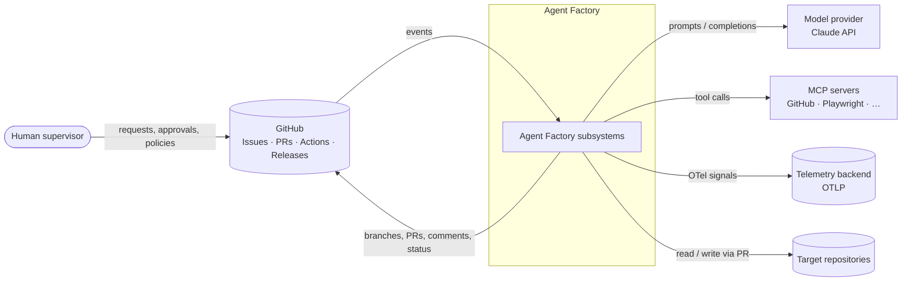
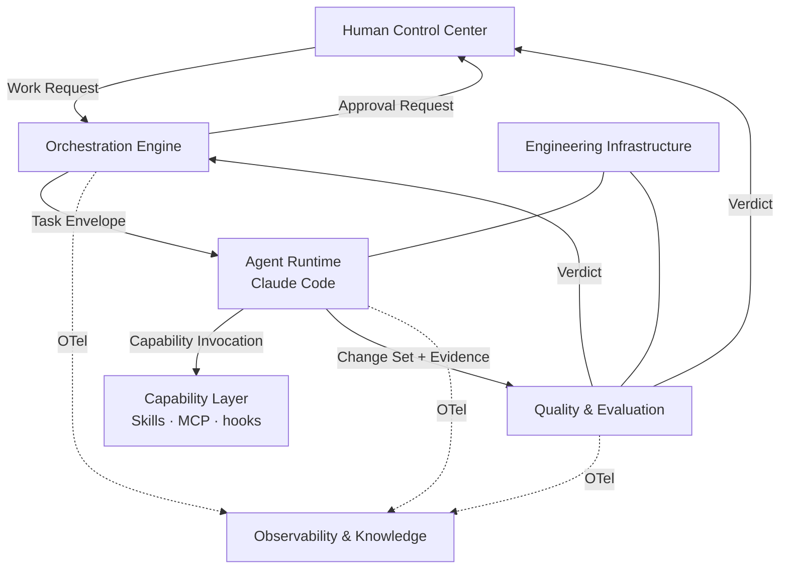
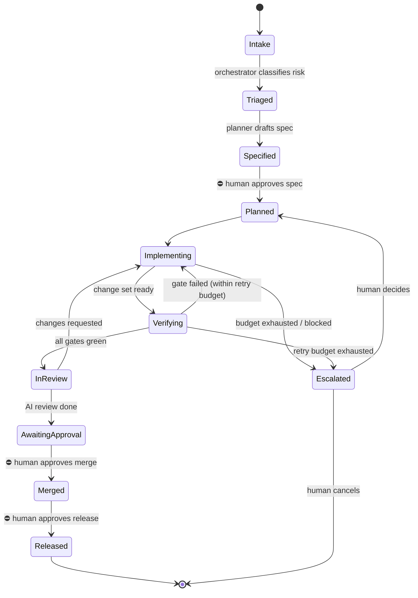

# System Overview

| | |
|---|---|
| **Status** | Draft — pending approval |
| **Last updated** | 2026-11-23 |
| **Related** | [Security Model](security-model.md) · [ADR-0001](../decisions/ADR-0001-architecture.md) |

## 1. Purpose and scope

Agent Factory is a reusable, human-supervised infrastructure of AI agents for software engineering. Its goal is to reach the **highest autonomy and quality that can be demonstrated with evidence**, while keeping humans in control of critical decisions.

This document describes:

- the subsystems and what each one is responsible for;
- the contracts between them;
- the task lifecycle and its human gates;
- the autonomy model;
- the phased roadmap.

Security controls are specified in the [Security Model](security-model.md). The rationale for the main technology choices is recorded in [ADR-0001](../decisions/ADR-0001-architecture.md).

**In scope:** planning, specifying, implementing, testing, reviewing and releasing software changes in GitHub repositories.

**Out of scope (for now):** production operations (on-call, incident remediation), autonomous deployment to production, and non-GitHub forges.

## 2. Quality goals and non-goals

| Priority | Quality goal | Meaning |
|---|---|---|
| 1 | **Safety and control** | No critical action without human approval. Guardrails are deterministic and cannot be modified by agents. |
| 2 | **Quality** | Every change is specified, tested and independently reviewed before merge. |
| 3 | **Traceability** | Every change can be traced: spec → task → agent run → PR → tests → release. |
| 4 | **Autonomy** | Agents complete end-to-end work without human help inside their authorized envelope. |
| 5 | **Portability** | The architecture does not depend on any particular target project, and the agent runtime can be replaced. |

**Non-goals:**

- Replacing human accountability for what ships.
- Building a general-purpose agent platform.
- Maximizing autonomy at the expense of verifiability.

## 3. Architectural principles

From the [README](../../README.md):

1. Human oversight over autonomous execution.
2. Small, verifiable changes.
3. Independent quality evaluation.
4. Explicit permissions and security boundaries.
5. Reusable architecture, independent of any particular project.

Added by this document:

6. **Contracts before implementations.** Subsystems interact through versioned, schema-defined artifacts, never through implicit conventions.
7. **Deterministic enforcement for mandatory rules.** Any rule that must always hold is enforced by hooks, permissions, CI or repository rulesets. A prompt alone never enforces a mandatory rule.
8. **Evidence-based autonomy.** Autonomy is granted per role and risk class, based on measured evaluation results, and can be revoked.
9. **GitHub as the system of record.** State, approvals and history live in GitHub, where humans already work.
10. **Least privilege everywhere.** Each agent role receives only the tools, data and credentials its task requires.

## 4. System context



Humans interact with Agent Factory **through GitHub**: they open issues, review PRs, approve environments and apply labels. Phase 1 has no separate UI.

## 5. Container view



Engineering Infrastructure is the substrate under every other subsystem: repository, CI/CD, runners, identity, secrets and sandboxes. Observability & Knowledge receives signals from every subsystem.

## 6. Subsystems

### 6.1 Human Control Center (HCC)

**Responsibilities:**

- Intake of work.
- Approval at critical gates.
- Configuration of autonomy policies and risk classes.
- Emergency stop.
- Audit visibility.

**Exposes:**

- *Work Request*, as a GitHub issue created from a template.
- Approval decisions, as PR reviews, environment approvals and labels.

**Consumes:** *Approval Request* and *Verdict*.

**Phase 1 implementation:**

- Issue forms.
- A label taxonomy (`state:*`, `risk:*`, `autonomy:*`, `agents:halt`).
- CODEOWNERS.
- Required reviewers on GitHub Environments.

**Evolution:** a read-only dashboard over GitHub and telemetry data. A dedicated UI only if GitHub proves insufficient.

### 6.2 Orchestration Engine

**Responsibilities:**

- Run the task state machine (§8).
- Decompose work into tasks.
- Route each task to an agent role.
- Enforce budgets (turns, wall-clock time, cost, retries).
- Apply the effective autonomy level (§13).
- Escalate to humans.

**Exposes:** *Task Envelope* and *Approval Request*.

**Consumes:** *Work Request* and *Verdict*.

**Phase 1 implementation:**

- An orchestrator Claude Code session (orchestrator role) that delegates to specialized subagents.
- GitHub Actions workflows that react to issue and PR events and start runs.
- Task state kept in GitHub labels, plus a machine-readable comment.

**Evolution:** if the native mechanisms hit measured limits (concurrency, durability, cross-repository coordination), introduce a dedicated orchestration service behind the same contracts. Candidates to evaluate first: Claude Code agent teams, dynamic workflows, and the Agent SDK.

### 6.3 Agent Runtime

**Responsibilities:**

- Execute one bounded task inside an isolated workspace, with a role-specific toolset.
- Produce a *Change Set* and *Evidence*.
- Emit telemetry.

**Exposes:** *Change Set + Evidence*.

**Consumes:** *Task Envelope*.

**Phase 1 implementation:** Claude Code.

- Interactive CLI for levels L0–L1.
- Headless mode (`claude -p`) or the Agent SDK for scripted runs.
- `anthropics/claude-code-action@v1` for runs triggered from CI.
- Roles are defined as subagents in `.claude/agents/*.md`.
- One branch, plus a git worktree when running locally, per task.

**Runtime Contract:** any runtime must:

- accept a Task Envelope;
- honor the permission policy;
- deliver changes only through a branch or PR;
- emit OTel signals with the correlation attributes in §14.

This keeps Claude Code replaceable.

### 6.4 Capability Layer

**Responsibilities:** provide agents with knowledge and tools in a governed, least-privilege way.

| Mechanism | Use for | Example |
|---|---|---|
| **Skill** (`.claude/skills/<name>/SKILL.md`) | Procedural know-how: *how* to do something | "write a spec", "add a Playwright test", "prepare a release" |
| **MCP server** | *Access* to an external system | GitHub, Playwright browser automation |
| **Hook** (`settings.json`) | Rules that must *always* hold | Block writes to protected paths; audit tool calls |
| **CLAUDE.md** | Persistent project *context* and conventions | Build commands, code style, architecture links |
| **Subagent** (`.claude/agents/*.md`) | A *role*: prompt, tools, model, isolated context | `implementer`, `reviewer` |

**Governance:**

- MCP servers and Skills are allowlisted and pinned.
- Adding or changing a capability requires a PR approved by a code owner. See [Security Model §11](security-model.md#11-capability-governance).

**Evolution:** package the reusable roles, Skills and hooks as a Claude Code **plugin**, so they can be installed into target repositories.

### 6.5 Quality & Evaluation

**Responsibilities:**

- Turn specs into acceptance tests.
- Run the quality gates.
- Perform independent review.
- Evaluate the agents themselves (EDD, §12).

**Exposes:** *Verdict* (`pass` | `fail` | `needs-human`, plus findings).

**Consumes:** *Change Set + Evidence*.

**Phase 1 quality gates, run by CI as required status checks:**

| Gate | Tooling (indicative) | Blocking |
|---|---|---|
| Lint, format, type check | Project-specific | Yes |
| Unit and integration tests, with a coverage threshold | Project-specific | Yes |
| End-to-end tests | Playwright | Yes, for UI-affecting changes |
| Static analysis (SAST) | CodeQL | Yes, on high severity |
| Secret scanning and push protection | GitHub | Yes |
| Dependency review | GitHub | Yes, on new high-severity vulnerabilities |
| Spec traceability check | Custom script (the PR references a spec) | Yes |
| AI review | `reviewer` and `security-reviewer` subagents | Advisory in phase 1 |
| Human review | CODEOWNERS | Yes |

### 6.6 Observability & Knowledge

**Responsibilities:**

- Collect correlated telemetry for every run.
- Compute cost and quality metrics.
- Preserve institutional knowledge.

**Phase 1 implementation:**

- **Telemetry:** Claude Code's native OpenTelemetry export, with metrics and events (logs). Distributed traces are beta and opt-in. Prompt content is off by default.
- **Correlation:** shared attributes (§14) on every signal, including CI signals.
- **Knowledge:** ADRs (`docs/decisions/`), specs (`specs/`), `CLAUDE.md`, and a lessons-learned log fed by retrospectives on failed or reverted runs.

**Open:** the telemetry backend (local stack or SaaS) is deferred to a follow-up ADR.

### 6.7 Engineering Infrastructure

**Responsibilities:**

- Provide reproducible execution environments, identity, secrets, CI/CD and branch protection.

**Phase 1 implementation:**

- GitHub repository rulesets: protected `main`, required checks, required code-owner review, no force push.
- GitHub Actions on ephemeral runners.
- A dedicated GitHub App identity for agents.
- A devcontainer for local reproducibility.
- OIDC for cloud credentials.
- The Claude Code Bash sandbox on Linux, macOS or WSL2.

## 7. Contracts between subsystems

All contracts are versioned (`contract: <name>/v<major>`). Phase 1 represents them as Markdown with YAML frontmatter, so humans and agents can both read them, plus JSON Schema files under `schemas/` (to be created).

| Contract | From → To | Key fields | Phase 1 carrier |
|---|---|---|---|
| **Work Request** | HCC → ORC | `objective`, `context`, `acceptance_criteria[]`, `risk_class`, `requested_autonomy` | Issue form |
| **Task Envelope** | ORC → RT | `task_id`, `spec_ref`, `role`, `allowed_capabilities[]`, `budget{turns, minutes, cost}`, `autonomy_level`, `workspace{repo, branch}` | Workflow inputs and prompt preamble |
| **Capability Invocation** | RT → CAP | MCP JSON-RPC, Skill load, tool call | Native Claude Code mechanisms, mediated by permissions and hooks |
| **Change Set + Evidence** | RT → QE | `branch`, `pr`, `spec_ref`, `tests_run[]`, `self_assessment`, `open_questions[]` | Pull request body (template) |
| **Verdict** | QE → ORC/HCC | `result`, `findings[]{severity, location, rationale}`, `gates{}` | Check runs and review comments |
| **Approval Request** | ORC → HCC | `action`, `risk_class`, `evidence_refs[]`, `alternatives[]`, `deadline` | PR review request, environment approval, or issue comment |
| **Telemetry** | All → OBS | OTel signals plus the attributes in §14 | OTLP |

Role manifests (§9) and these contracts are designed so they can later be published as **A2A Agent Cards** (§16).

## 8. Task lifecycle



⛔ marks a human gate. Spec approval can be delegated for risk class R0 once the planner role reaches L3 (§13).

## 9. Agent model

**Initial role catalog:**

| Role | Purpose | Key tools | Writes code |
|---|---|---|---|
| `orchestrator` | Triage, decomposition, routing, budget tracking | Agent (delegation), GitHub | No |
| `planner` | Draft spec and task plan from a Work Request | Read, search, GitHub | Specs only |
| `implementer` | Implement one task on its branch | Read, Edit, Bash (sandboxed) | Yes |
| `test-author` | Derive tests from acceptance criteria | Read, Edit, Bash, Playwright MCP | Tests only |
| `reviewer` | Independent code review against spec and standards | Read-only | No |
| `security-reviewer` | Security-focused review | Read-only | No |
| `docs` | Documentation updates | Read, Edit (docs paths) | Docs only |

**Delegation depth:** Claude Code allows nested subagents, with a configurable maximum depth (`CLAUDE_CODE_MAX_SUBAGENT_SPAWN_DEPTH`, default 3 at the time of writing). By policy, phase 1 uses a **depth of 1**: only `orchestrator` holds the Agent tool, and worker roles cannot delegate further. This keeps runs auditable and costs bounded. Raising the depth requires an ADR.

**Independence:** `reviewer` runs in a fresh context. It never sees the implementer's reasoning, only the spec, the diff and the evidence. It can be configured to use a different model.

**Model selection:** each role's model is configuration, not code. Indicative defaults: a top-tier model for `planner` and the review roles, a balanced model for `implementer` and `test-author`, and a fast model for triage.

## 10. Capability selection guide

```
Must it ALWAYS happen or NEVER happen?  → hook / permission rule / CI gate / ruleset
Does the agent need to reach an external system?  → MCP server (allowlisted)
Is it a repeatable procedure or know-how?  → Skill
Is it a stable fact or convention about this project?  → CLAUDE.md
Is it a distinct responsibility with its own tools and context?  → subagent role
```

## 11. Spec-Driven Development (SDD)

The spec is the source of truth for intent. Every change is traced from a spec to tests.

```
specs/<id>-<slug>/
  requirements.md   # user stories + acceptance criteria (Given/When/Then)
  design.md         # approach, affected components, risks (optional for R0)
  tasks.md          # ordered, independently verifiable tasks
```

**Rules:**

1. Implementation does not start until the spec is approved (human gate for R1 and above).
2. Every PR references exactly one spec and the task IDs it implements.
3. Every acceptance criterion maps to at least one automated test. CI checks the mapping.
4. Specs change through PRs like code. Divergence between spec and code counts as a defect.

The format is kept minimal and compatible with existing SDD tooling (for example GitHub Spec Kit), so adopting such a tool later stays cheap.

## 12. Evaluation-Driven Development (EDD)

Agents, Skills and prompts are software. They are developed against evaluations.

```
evals/
  roles/<role>/        # golden tasks per agent role
  skills/<skill>/      # golden cases per Skill
  datasets/            # fixtures and seed repositories
```

- **When evals run:** in CI, on any change to `.claude/agents/`, `.claude/skills/`, `CLAUDE.md`, hooks or model configuration, and on a schedule to detect model drift.
- **Metrics:**
  - task success rate (pass@1 and pass@k);
  - gate pass rate on the first attempt;
  - rework rate;
  - review precision and recall (on seeded defects);
  - cost and time per task;
  - escaped defects (found after merge).
- **Regression policy:** a change that lowers a role's success rate below its threshold cannot be merged.
- **Link to autonomy:** eval results decide which autonomy level each role has earned (§13).
- **Tooling (to be evaluated):** Claude Code's plugin evaluation (`claude plugin eval`) for Skills and roles, plus a custom harness for end-to-end tasks.

## 13. Autonomy levels and risk classes

**Autonomy levels:**

| Level | Name | Agent may | Human must |
|---|---|---|---|
| L0 | Advisor | Read and propose | Do everything |
| L1 | Assisted | Make local changes; each effectful action is approved | Approve each action |
| L2 | Supervised | Create branches and PRs, run CI | Approve the spec and the merge |
| L3 | Conditional | Auto-merge **R0** changes when all gates pass | Audit after the fact; approve everything above R0 |
| L4 | Autonomous | Release | Out of scope |

**Risk classes** (assigned at triage; the highest applicable class wins):

| Class | Examples |
|---|---|
| R0 | Docs, comments, tests only |
| R1 | Application code covered by tests |
| R2 | Dependencies, data schemas, public APIs, performance-sensitive paths |
| R3 | Security, authentication, CI/CD, infrastructure, data deletion or migration, agent configuration (`.claude/**`, hooks, `CODEOWNERS`, `.github/**`) |

**Effective autonomy** = `min(ceiling for the risk class, level earned by the role through evals, level requested in the Work Request)`.

- The **phase 1 ceiling is L2** for every class.
- **R3 is capped at L2 permanently.**
- The actions that always need a human are listed in [Security Model §13](security-model.md#13-autonomy-and-human-approval-matrix).

## 14. Observability

**Signals:**

- Claude Code native OTel export: metrics (tokens, cost, sessions, lines changed, tool decisions) and events (tool results, API requests).
- Optional traces (beta).
- CI job telemetry.

**Correlation attributes** (resource or span attributes on every signal):

| Attribute | Example |
|---|---|
| `af.task.id` | `GH-123` |
| `af.spec.id` | `0007-login-rate-limit` |
| `af.agent.role` | `implementer` |
| `af.run.id` | GitHub Actions run ID or local UUID |
| `af.autonomy.level` | `L2` |
| `af.risk.class` | `R1` |
| `vcs.repository.name`, `vcs.ref.head.name` | Repository and branch |

**Conventions:**

- Follow the OpenTelemetry GenAI semantic conventions (`gen_ai.*`) where they apply.
- Those conventions are still in development, so pin the version used and review it when upgrading.

**Key metrics (dashboards):**

- Cost per task and per role.
- Success rate by role and risk class.
- Time from intake to merge.
- Number of human interventions per task.
- Escaped defects.
- Reverted PRs.

**Privacy:** collecting prompt text, tool details and tool content is **off** by default. See [Security Model §14](security-model.md#14-data-and-privacy).

## 15. Knowledge management

| Artifact | Location | Owner | Updated when |
|---|---|---|---|
| Architecture decisions | `docs/decisions/ADR-NNNN-*.md` (MADR) | Humans (agents may draft) | Any significant or irreversible decision |
| Architecture docs | `docs/architecture/` | Humans | When an ADR changes the architecture |
| Specs | `specs/` | Planner drafts, humans approve | Per feature |
| Project context | `CLAUDE.md` | Humans (protected path) | When conventions change |
| Lessons learned | `docs/lessons/` | Orchestrator drafts, humans approve | After failed, escalated or reverted runs |

Agents may *propose* knowledge updates. Persistent instructions such as `CLAUDE.md` and Skills are protected paths and change only through human-approved PRs, which guards against context poisoning.

## 16. Future interoperability: A2A

Agent2Agent (A2A) reached v1.0 in 2026. Agent Factory **does not implement A2A in phase 1**, but stays compatible with it:

- Each role manifest (name, description, skills, inputs, outputs, auth requirements) maps directly onto an A2A **Agent Card**.
- The task lifecycle (§8) maps onto A2A task states.
- Contracts are transport-independent JSON-serializable documents.

A2A support will be considered when an external agent, or a second runtime, must collaborate with Agent Factory. It requires its own ADR and a security review of the inter-agent trust boundaries.

## 17. Proposed repository layout

```
.claude/
  agents/            # role definitions (subagents)
  skills/            # Skills
  settings.json      # shared permissions and hooks (protected)
.github/
  ISSUE_TEMPLATE/    # Work Request forms
  workflows/         # CI gates and agent triggers (protected)
  CODEOWNERS
  pull_request_template.md
docs/
  architecture/      # this document, security model
  decisions/         # ADRs
  lessons/
evals/               # EDD suites
schemas/             # contract JSON Schemas
specs/               # SDD specs
CLAUDE.md
```

## 18. Roadmap

| Phase | Goal | Exit criteria |
|---|---|---|
| **F0 Foundations** | Architecture, security model, ADR-0001 approved | Documents merged |
| **F1 Vertical slice** | One issue → spec → PR → gates → human merge, at L2, on a pilot repository | 10 tasks completed end to end; metrics visible; no guardrail bypass |
| **F2 Evidence** | Eval suites per role; L3 for R0 where earned | Eval thresholds met and stable across 2 model updates |
| **F3 Scale** | Plugin packaging, multiple repositories, orchestration service if needed, A2A if needed | Decided by ADRs based on F1 and F2 data |

## 19. Glossary

| Term | Definition |
|---|---|
| **ADR** | Architecture Decision Record |
| **A2A** | Agent2Agent protocol for inter-agent communication |
| **Agent Card** | A2A document that describes an agent's identity, capabilities and endpoints |
| **EDD** | Evaluation-Driven Development |
| **Gate** | A check that must pass, automated or human, before a lifecycle transition |
| **Hook** | Deterministic script that Claude Code runs on lifecycle events (for example `PreToolUse`) |
| **MCP** | Model Context Protocol, a standard for connecting agents to tools and data |
| **OTel** | OpenTelemetry |
| **Role** | An agent specialization, implemented as a Claude Code subagent |
| **SDD** | Spec-Driven Development |
| **Skill** | A packaged, reusable set of instructions and resources that Claude loads on demand |
